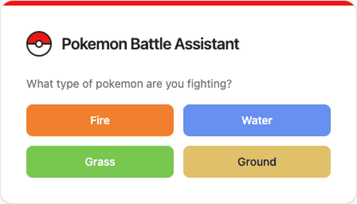

# HelloHacksWorkshop2026

This is the starter version of the Hello Hacks Workshop. We've created folders for the backend code and the frontend code that you can start with. 

Please begin by forking this repository to make your own copy that you can experiment with. You'll also notice there are branches for each stage of our project in case you get stuck and want to catchup. (If you're confused, that's okay! We'll explain everything and there will be people who you can ask for help.)

## Demo

The finished workshop project (on the [`final-project`](../../tree/final-project) branch): a React + Tailwind front end that asks an Express back end for type matchups, which it looks up from [PokeAPI](https://pokeapi.co).

made by: Nicole Li